# GRIDZILLA — FIRMWARE 1.4

## 🟢 [DOWNLOAD GRIDZILLA FOR FIRMWARE 1.4](https://github.com/ZootedandRebooted/GRIDZILLA-1.4/releases/download/v1.4.0/GRIDZILLA-1.4.zip)

> [!TIP]
> **Firmware 1.4 is ready.** The download includes the automatic-startup installer and all nine Henry Skillz effects.
> [Open the 1.4 repository](https://github.com/ZootedandRebooted/GRIDZILLA-1.4) · [Read the 1.4 installation guide](https://github.com/ZootedandRebooted/GRIDZILLA-1.4/blob/main/INSTALLATION.md)

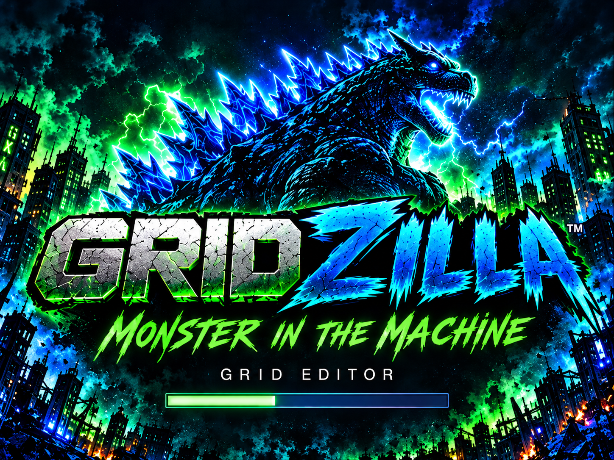

**Gridzilla for Akai MPC Sample firmware 1.4.0.8 (d87ac8c12e9), with standalone automatic startup.**

Download the compiled package from [Releases](https://github.com/ZootedandRebooted/GRIDZILLA-1.4/releases/latest). Install once, restart with the SD card inserted, and Gridzilla loads automatically—no Mac connection and no recurring Autorun confirmation.

The package includes the Grid and Melodic editors, Arranger, Mixer, instruments and banks, Flex Beat, nine Henry Skillz effects, and the automatic-startup installer and removal tool. New songs start with empty Master insert slots; saved effects and project editing remain supported.

**Installation requires one initial Autorun Yes confirmation.** That installer removes itself from the SD root after success. Later restarts need no confirmation. Enable Developer Mode and Custom Plug-In Support before installation. Read the [installation and recovery guide](INSTALLATION.md).

This repository contains documentation and images. Release downloads contain compiled runtime files and the scripts needed to install and launch them. **Application source code is not included.** GitHub's automatically generated “Source code” archives contain only this documentation repository; download `GRIDZILLA-1.4.zip` for the application.

## Gridzilla gallery

The existing gallery from the firmware 1.3 release is retained below, as requested. These images illustrate the interfaces carried forward into the 1.4 build.

| Grid | Arranger |
| --- | --- |
| 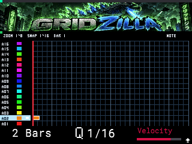 | 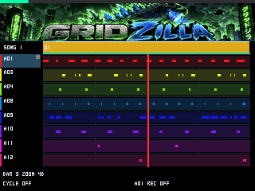 |
| Mixer | Inserts |
| 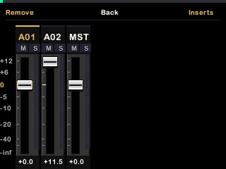 | 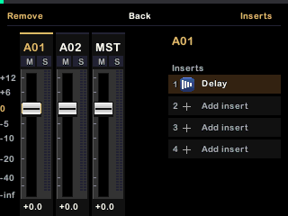 |
| Melodic | Instruments |
| 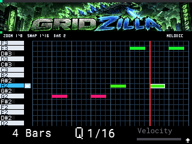 | 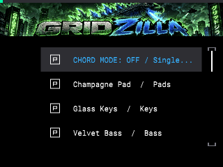 |

## Henry Skillz plugins

Open **SHIFT + PAD 5 → pad or MASTER → Inserts**. The three knobs edit the displayed controls; the middle soft button changes pages and the right button toggles bypass.

These HS images come from the existing Gridzilla integration: seven MPC screen captures, plus the Saturator and Bass Focus rendered editor frames. They show the editors carried forward into 1.4.

| Heat | Pump | Bus Compressor |
| --- | --- | --- |
| 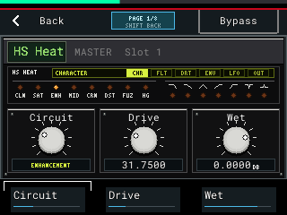 | 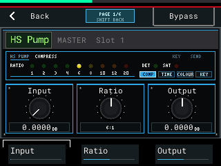 | 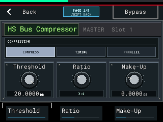 |
| Channel Strip | Para EQ | Tube Strip |
| 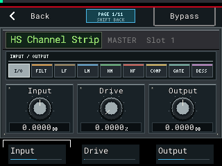 | 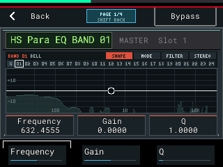 | 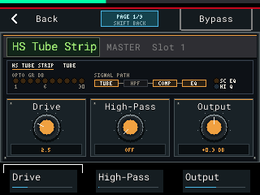 |
| Bass Focus | Crush | Saturator |
| 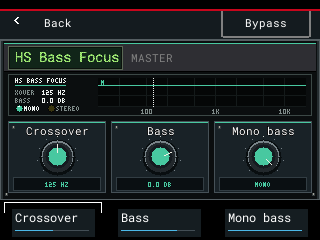 | 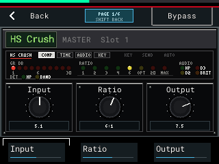 | 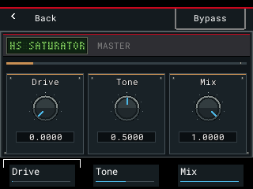 |

Henry Skillz's DSP is credited under its included MIT notice. Roboto Mono notices and license are also included in the download.

## Verification

The 1.4 runtime passed native MPC qualification covering editing, Undo/Redo, save/reload, instruments, routing, Flex Beat, all nine Henry effects, audio checks and orderly shutdown. Standalone automatic startup was verified through full restarts, including a physical restart disconnected from the Mac. Checksums accompany the downloadable package.

The previous firmware 1.3 release remains available in the [original GRIDZILLA repository](https://github.com/ZootedandRebooted/GRIDZILLA).
